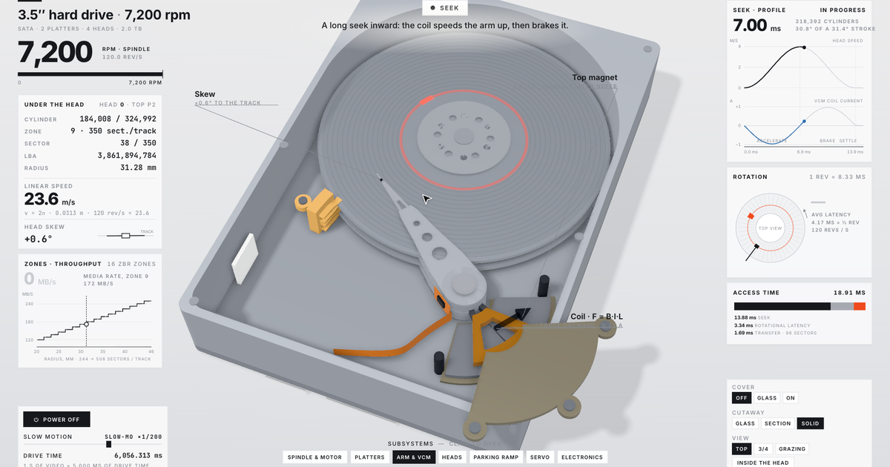

# Spindl

A 3.5-inch, 7,200 rpm desktop hard drive (SATA, 2 platters, 4 heads) you can take apart in the browser. It spins up,
loads its heads off the ramp, reads a track, seeks across the platter with the speed profile drawn live, waits for
its sector, flies 3 nanometres above the surface, and parks on the ramp when the power goes. Every gauge reads the
same model that moves the parts.

**Live:** <https://spindl.storagebits.workers.dev> (English, French, Spanish).

> Spindl now lives in [Exploded](https://github.com/algotitanhq/exploded), a collection of machines taken apart in
> the browser: <https://exploded.storagebits.workers.dev/en/spindl/>. This repository and its site stay as they are.



## What you can do

- **Subsystems:** spindle & motor (a section through the stack), platters (an exploded view, four heads on one
  cylinder), arm & VCM (the top magnet lifted, the force on the coil changing sign mid-seek), heads (a camera down to
  the slider and its air bearing), parking ramp, servo wedges, electronics (the PCB swung out, the preamp on the flex).
- **Cover** off / glass / on, **cutaway** glass / section / solid, **views** top / 3/4 / grazing / inside the head.
- **Power** on and off: a real spin-up, then an emergency park on the spindle's back-EMF.
- **Random request:** any LBA on the disk, with its seek, its rotational wait and its transfer.
- **Slow motion** from real time to 1/8000: a seek lasts 14 ms, a revolution 8.33 ms.
- Left alone, the page plays a guided tour; any click hands control over.

## The model

One input, the drive time τ. Every pose and every number is a function of it (`hdd/hdd-shared/kin.js`, no three.js).

| Figure | Value | How |
|---|---|---|
| Spindle | 7,200 rpm = 120 rev/s, 8.333 ms a turn, 4.167 ms average latency | θ(τ) = 2π · 120 · τ once spun up; spin-up and coast-down in closed form |
| Linear speed under the head | 15.08 m/s at r = 20 mm, 34.68 m/s at r = 46 mm | v = 2π · r · 120 |
| Rotary actuator | pivot → head 48 mm, 31.4° of stroke over the data band, skew −16.6° → +15.3° | law of cosines on the pivot–spindle–head triangle |
| Seek | 0.92 ms track to track, 8.51 ms over a third of the stroke, 14.0 ms full stroke | cycloidal (smoothed bang-bang) move + 0.9 ms settle; peak 4.0 m/s, 98 g, 0.97 A |
| Zoned recording | 16 zones, 508 → 244 sectors of 4 KiB per track, 250 → 120 MB/s | 80 nm track pitch, 324,992 cylinders × 4 surfaces = 2.0 TB |
| Flying height | ≈ 3 nm | shown on a log scale, not to scale in 3D |

A request queue (LBA → zone, cylinder, head, sector) is planned once: each seek follows the profile, then waits for
its sector to come round. `node hdd/check.mjs` recomputes every figure above and fails outside the brief's ranges.

Drawn larger than life on purpose, and labelled as such on screen: the track ring, the target sector (at least 3°
wide), the magnified tracks and the flying gap during the dive.

The geometry was built against photographs of real drives; the sources are listed in
[`hdd/REFERENCES.md`](hdd/REFERENCES.md).

## Build

```sh
npm ci
npm run check     # the figures and the root language choice
npm run build     # dist/{en,fr,es}/index.html, one self-contained page each (< 1 MB), dist/_headers
```

Open `dist/en/index.html` directly, or any page with `?lang=fr` / `?lang=es`.

The film (31 s, 1080p60, with its sound) is recorded frame by frame from the same code with the
[teardown](https://github.com/whaleyxbt/claude-motion) kit's capture tools; see [`docs/film.md`](docs/film.md).

## Deploy

| Key | Kind | Where | Role |
|---|---|---|---|
| `PUBLIC_RELEASE` | repository variable | GitHub Actions | The deploy step runs only when it is `true`. |
| `CLOUDFLARE_API_TOKEN` | organization secret (`algotitanhq`) | GitHub Actions | "Workers Scripts: Edit" on the one account that hosts the Worker; the deploy step looks the account up and masks its ID. |
| `wrangler.jsonc` | file | repository | Cloudflare Workers static assets serving `dist/`, a Worker for `/` only (a 302 to the first of en, fr, es in the browser's order of preference). No preview URLs. |

`.github/workflows/ci.yml` checks and builds every push; it deploys only from `main`, once `PUBLIC_RELEASE` is
`true`. Never add repository-level copies of the organization's keys. `dist/_headers` sets HSTS, no framing and a
Content-Security-Policy that allows the page's single inline script by its hash, computed at build time.

## Layout

| Path | What it holds |
|---|---|
| `hdd/hdd-shared/kin.js` | The drive as numbers: geometry, zones, LBA mapping, seek profile, the planner, `driveAt(τ)`. |
| `hdd/hdd-shared/drive.js` | The parts, built from code in millimetres; the platter surface shader. |
| `hdd/hdd-shared/stage.js` | Studio, lights, shadows, ambient occlusion. |
| `hdd/hdd-shared/console.js` | The overlay: panels, charts, buttons, callouts. |
| `hdd/hdd-shared/tour.js` | The tour's clock (film time → drive time) and its request queue. |
| `hdd/hdd-shared/film.js` | The tour as a pure function of time. |
| `hdd/hdd-shared/live.js` | The page you drive, which plays the tour when left alone. |
| `hdd/hdd-shared/i18n.js` | Every word on screen, in English, French and Spanish. |
| `hdd/hdd-shared/score.py` | The film's sound: the spindle's hum, a click per seek, the tac of the park. |
| `kit/` | The teardown kit's runtime (MIT, `kit/LICENSE`). |
| `worker/` | The root's language redirect. |

## Credits

Built with Claude Code (Claude Opus 5.5) and the teardown skill, whose kit, frame capture and sound engine come from
[whaleyxbt/claude-motion](https://github.com/whaleyxbt/claude-motion) (MIT). three.js (MIT). Inter and JetBrains
Mono (SIL Open Font License).

## License

MIT, see [LICENSE](LICENSE).
